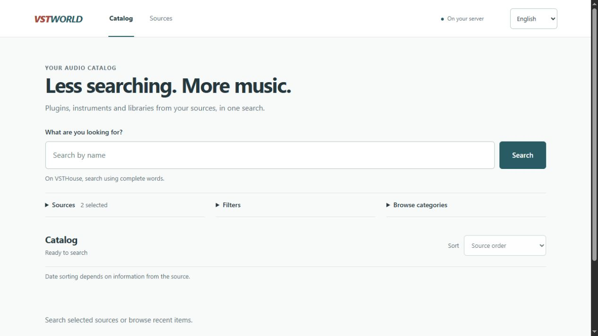

<div align="center">

# VSTWorld

English · [Português (BR)](README.md) · [Español](README.es.md)

**Plugins, instruments, and audio libraries. One search, multiple sources.**

A free, self-hosted catalog for searching product information and download links through an interface without source-site ads.

[](https://github.com/viy2tek/VSTWorld/releases/tag/v0.3.0-beta.2)
[](https://github.com/viy2tek/VSTWorld/actions/workflows/checks.yml)
[](LICENSE)

**[Download for Windows x64](https://github.com/viy2tek/VSTWorld/releases/download/v0.3.0-beta.2/VSTWorld-windows-x64.exe)** · [Documentation](#documentation) · [Report an issue](https://github.com/viy2tek/VSTWorld/issues)

</div>



<p align="center"><sub>Available in Portuguese, English, and Spanish.</sub></p>

## Features

- **Unified search:** live queries, categories, and pagination for each source.
- **Filters:** operating system, format, architecture, and other data found in loaded items.
- **Organized details:** specifications, installation instructions, zoomable screenshots, videos, and identified downloads.
- **Configurable sources:** add a site by URL; technical settings are tucked under Advanced.
- **Optional translation:** local LibreTranslate or Ollama, with access to the original text.
- **Runs on your computer or server:** no account, database, or required paid service.

## Get started

### Windows

1. [Download the executable](https://github.com/viy2tek/VSTWorld/releases/download/v0.3.0-beta.2/VSTWorld-windows-x64.exe) and open it.
2. Wait for your browser to open, search, and select a title to view its details.
3. Use the **W** icon in the system tray, near the clock, to open or quit the app.

Python, Node, and Docker are not required. Before updating, quit the previous version and keep only one instance running. Saved sources are preserved. The executable is not digitally signed and does not update automatically; [release files](https://github.com/viy2tek/VSTWorld/releases/tag/v0.3.0-beta.2) include the SHA-256 checksum.

The app opens its address automatically. The `vstworld.local` name requires local computer configuration; an alternate port is used if port 80 is occupied. [Windows app guide](docs/DESKTOP.md).

<details>
<summary><strong>Docker or run from source</strong></summary>

With Git, Docker, and Compose installed:

```sh
git clone https://github.com/viy2tek/VSTWorld.git
cd VSTWorld
docker compose up --build -d
```

Open [http://127.0.0.1:8787](http://127.0.0.1:8787). Data is stored in the `source-data` volume.

[Docker, backups, and remote access](docs/GUIA_TECNICO.md#docker-e-acesso-remoto) · [Run with Python 3.14](docs/DEVELOPMENT.md#executar-pelo-código)

The Docker workflow is documented but has not been validated in a live run. The app has no built-in authentication; keep access local or protect it on your server.

</details>

## Sources

| Source | Availability |
| --- | --- |
| **VSTHouse** | Included primary source. |
| **Plugins4Free** | Included, with compatible native filters. |
| **Musicmakers** | Experimental candidate, disabled; integration is incomplete. |

To add a site, open **Sources → Add source**, paste its address, and select **Identify site**. Review the checks before saving. Site identification is not universal; some sites need a dedicated connector. [Configure sources](docs/GUIA_TECNICO.md#configurar-fontes-em-detalhe).

## Documentation

| Topic | Guide |
| --- | --- |
| Local hostname, tray, and logs | [Windows app](docs/DESKTOP.md) |
| Sources, server, and backups | [Technical guide](docs/GUIA_TECNICO.md) |
| Filters, dates, and sorting | [Search filters](docs/FILTERS.md) |
| Translate details or set up local AI | [Translation](docs/TRANSLATION.md) · [Ollama](docs/LOCAL_AI.md) |
| Run tests or build the executable | [Development](docs/DEVELOPMENT.md) |

[Changelog](CHANGELOG.md) · [Roadmap](docs/ROADMAP.md) · [Beta verification](docs/RELEASE_0_3.md)

## Before you use it

VSTWorld is in **beta**. Searches require internet access; changes or restrictions on source sites can affect results and downloads. Local filters and sorting cover loaded items only. [Inspected sources and limitations](docs/FREE_SOURCES_INSPECTION.md).

Translation and AI require separately installed local services and models. Quality with real models has not been measured. Videos depend on YouTube and may contain their own ads.

The app provides links; it does not include or host products. Licenses, file integrity, and security are not verified; torrents require an external client. Follow source-site terms and content licenses. [Extraction policy](docs/INSPECAO.md).

## Contributing

Found an issue? [Open an issue](https://github.com/viy2tek/VSTWorld/issues) with the app version, operating system, and reproduction steps. To contribute code, submit a pull request with the change and its verification. New sources require documented inspection and tests.

## License

[DWL](LICENSE) · © 2026 [viy2tek](https://github.com/viy2tek). Independent project, not affiliated with source sites or manufacturers. Content and dependencies retain their own licenses.
