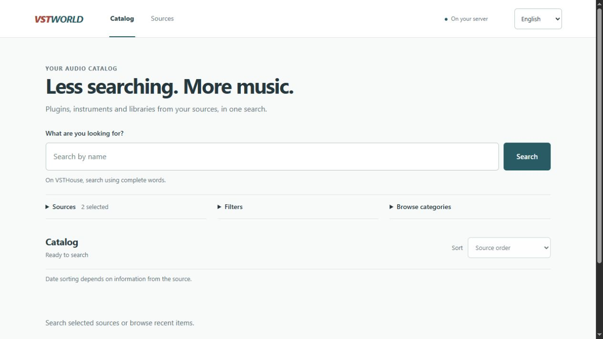

<div align="center">

# VSTWorld

Español · [Português (BR)](README.md) · [English](README.en.md)

**Plugins, instrumentos y bibliotecas de audio. Una búsqueda, varias fuentes.**

Un catálogo gratuito y autoalojado para consultar información de productos y enlaces de descarga desde una interfaz sin anuncios de los sitios de origen.

[](https://github.com/viy2tek/VSTWorld/releases/tag/v0.3.0-beta.2)
[](https://github.com/viy2tek/VSTWorld/actions/workflows/checks.yml)
[](LICENSE)

**[Descargar para Windows x64](https://github.com/viy2tek/VSTWorld/releases/download/v0.3.0-beta.2/VSTWorld-windows-x64.exe)** · [Documentación](#documentación) · [Informar un problema](https://github.com/viy2tek/VSTWorld/issues)

</div>



<p align="center"><sub>Disponible en portugués, inglés y español.</sub></p>

## Funciones

- **Búsqueda unificada:** consultas en tiempo real, categorías y paginación por fuente.
- **Filtros:** sistema operativo, formato, arquitectura y otros datos detectados en los elementos cargados.
- **Detalles organizados:** ficha técnica, instrucciones de instalación, capturas ampliables, vídeos y descargas identificadas.
- **Fuentes configurables:** añade sitios mediante su URL; los ajustes técnicos están en la sección avanzada.
- **Traducción opcional:** LibreTranslate u Ollama locales, con acceso al texto original.
- **En tu ordenador o servidor:** sin cuenta, base de datos ni servicio de pago obligatorio.

## Primeros pasos

### Windows

1. [Descarga el ejecutable](https://github.com/viy2tek/VSTWorld/releases/download/v0.3.0-beta.2/VSTWorld-windows-x64.exe) y ábrelo.
2. Espera a que se abra el navegador, busca y selecciona un título para ver sus detalles.
3. Usa el icono **W** de la bandeja del sistema, junto al reloj, para abrir o cerrar la aplicación.

No requiere Python, Node ni Docker. Antes de actualizar, cierra la versión anterior y deja abierta una sola instancia. Las fuentes guardadas se conservan. El ejecutable no tiene firma digital ni se actualiza automáticamente; los [archivos de la versión](https://github.com/viy2tek/VSTWorld/releases/tag/v0.3.0-beta.2) incluyen el checksum SHA-256.

La aplicación abre su dirección automáticamente. El nombre `vstworld.local` requiere configuración en el ordenador; se usa un puerto alternativo si el puerto 80 está ocupado. [Guía de la aplicación para Windows](docs/DESKTOP.md).

<details>
<summary><strong>Docker o ejecución desde el código</strong></summary>

Con Git, Docker y Compose instalados:

```sh
git clone https://github.com/viy2tek/VSTWorld.git
cd VSTWorld
docker compose up --build -d
```

Abre [http://127.0.0.1:8787](http://127.0.0.1:8787). Los datos se guardan en el volumen `source-data`.

[Docker, copias de seguridad y acceso remoto](docs/GUIA_TECNICO.md#docker-e-acesso-remoto) · [Ejecutar con Python 3.14](docs/DEVELOPMENT.md#executar-pelo-código)

El flujo de Docker está documentado, pero no se ha validado en una ejecución real. La aplicación no incluye autenticación; limita el acceso al equipo local o protégelo en tu servidor.

</details>

## Fuentes

| Fuente | Disponibilidad |
| --- | --- |
| **VSTHouse** | Fuente principal incluida. |
| **Plugins4Free** | Incluida, con filtros nativos compatibles. |
| **Musicmakers** | Candidata experimental desactivada; integración incompleta. |

Para añadir un sitio, abre **Fuentes → Añadir fuente**, pega su dirección y selecciona **Identificar sitio**. Revisa las comprobaciones antes de guardar. La identificación no funciona con todos los sitios; algunos requieren un conector específico. [Configurar fuentes](docs/GUIA_TECNICO.md#configurar-fontes-em-detalhe).

## Documentación

| Tema | Guía |
| --- | --- |
| Nombre local, bandeja y registros | [Aplicación para Windows](docs/DESKTOP.md) |
| Fuentes, servidor y copias de seguridad | [Guía técnica](docs/GUIA_TECNICO.md) |
| Filtros, fechas y ordenación | [Filtros de búsqueda](docs/FILTERS.md) |
| Traducir detalles o configurar IA local | [Traducción](docs/TRANSLATION.md) · [Ollama](docs/LOCAL_AI.md) |
| Ejecutar pruebas o generar el ejecutable | [Desarrollo](docs/DEVELOPMENT.md) |

[Historial de cambios](CHANGELOG.md) · [Plan de desarrollo](docs/ROADMAP.md) · [Verificación de la beta](docs/RELEASE_0_3.md)

## Antes de usar

VSTWorld está en **beta**. Las búsquedas requieren internet; los cambios o restricciones de los sitios de origen pueden afectar los resultados y las descargas. Los filtros y la ordenación locales solo consideran los elementos cargados. [Fuentes inspeccionadas y limitaciones](docs/FREE_SOURCES_INSPECTION.md).

La traducción y la IA requieren servicios y modelos locales instalados por separado. La calidad con modelos reales aún no se ha medido. Los vídeos dependen de YouTube y pueden incluir sus propios anuncios.

La aplicación muestra enlaces; no incluye ni aloja los productos. No se verifican las licencias, la integridad ni la seguridad de los archivos; los torrents requieren un cliente externo. Respeta las condiciones de los sitios de origen y las licencias del contenido. [Política de extracción](docs/INSPECAO.md).

## Colaborar

¿Encontraste un problema? [Abre una incidencia](https://github.com/viy2tek/VSTWorld/issues) con la versión, el sistema operativo y los pasos para reproducirlo. Para contribuir con código, envía un pull request con el cambio y su verificación. Las nuevas fuentes requieren una inspección documentada y pruebas.

## Licencia

[DWL](LICENSE) · © 2026 [viy2tek](https://github.com/viy2tek). Proyecto independiente, sin afiliación con los sitios de origen ni los fabricantes. El contenido y las dependencias conservan sus propias licencias.
