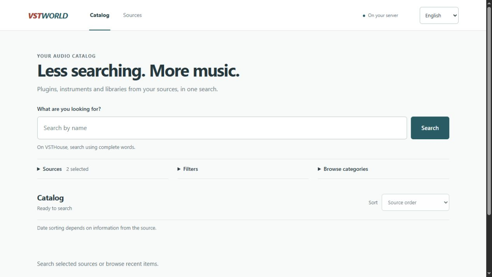

<div align="center">

# VSTWorld

Português (BR) · [English](README.en.md) · [Español](README.es.md)

**Plugins, instrumentos e bibliotecas de áudio. Uma busca, várias fontes.**

Um catálogo gratuito e self-hosted para consultar informações e links de download em uma interface sem os anúncios das páginas de origem.

[](https://github.com/viy2tek/VSTWorld/releases/tag/v0.3.0-beta.2)
[](https://github.com/viy2tek/VSTWorld/actions/workflows/checks.yml)
[](LICENSE)

**[Baixar para Windows x64](https://github.com/viy2tek/VSTWorld/releases/download/v0.3.0-beta.2/VSTWorld-windows-x64.exe)** · [Documentação](#documentação) · [Reportar problema](https://github.com/viy2tek/VSTWorld/issues)

</div>



<p align="center"><sub>Interface disponível em português, inglês e espanhol.</sub></p>

## Recursos

- **Busca unificada:** consultas ao vivo, categorias e paginação por fonte.
- **Filtros:** sistema, formato, arquitetura e outros dados identificados nos itens carregados.
- **Detalhes organizados:** ficha técnica, instalação, screenshots ampliáveis, vídeos e downloads identificados.
- **Fontes configuráveis:** cadastro por link e configurações técnicas recolhidas em Avançadas.
- **Tradução opcional:** LibreTranslate ou Ollama locais, com acesso ao texto original.
- **No seu computador ou servidor:** sem conta, banco de dados ou serviço pago obrigatório.

## Começar

### Windows

1. [Baixe o executável](https://github.com/viy2tek/VSTWorld/releases/download/v0.3.0-beta.2/VSTWorld-windows-x64.exe) e abra com dois cliques.
2. Aguarde o navegador abrir, pesquise e clique em um título para ver os detalhes.
3. Use o ícone **W** na bandeja, perto do relógio, para abrir ou encerrar o app.

Não exige Python, Node ou Docker. Ao atualizar, encerre a versão anterior e mantenha apenas uma instância aberta. Suas fontes salvas são preservadas. O executável ainda não tem assinatura digital nem atualização automática; os [arquivos do release](https://github.com/viy2tek/VSTWorld/releases/tag/v0.3.0-beta.2) incluem o checksum SHA-256.

O endereço abre automaticamente. O nome `vstworld.local` exige configuração no computador; uma porta alternativa aparece se a porta 80 estiver ocupada. [Guia do aplicativo Windows](docs/DESKTOP.md).

<details>
<summary><strong>Docker ou execução pelo código</strong></summary>

Com Git, Docker e Compose instalados:

```sh
git clone https://github.com/viy2tek/VSTWorld.git
cd VSTWorld
docker compose up --build -d
```

Abra [http://127.0.0.1:8787](http://127.0.0.1:8787). Os dados ficam no volume `source-data`.

[Docker, backup e acesso remoto](docs/GUIA_TECNICO.md#docker-e-acesso-remoto) · [Executar com Python 3.14](docs/DEVELOPMENT.md#executar-pelo-código)

O fluxo Docker está documentado, mas ainda não foi validado em execução. O app não possui autenticação própria; mantenha o acesso local ou protegido no servidor.

</details>

## Fontes

| Fonte | Disponibilidade |
| --- | --- |
| **VSTHouse** | Fonte principal incluída. |
| **Plugins4Free** | Incluída, com filtros nativos compatíveis. |
| **Musicmakers** | Candidata experimental, desativada; integração incompleta. |

Para cadastrar outro site, abra **Fontes → Adicionar fonte**, cole o endereço e use **Identificar site**. Revise as verificações antes de salvar. A identificação não é universal e alguns sites exigem um conector específico. [Configurar fontes](docs/GUIA_TECNICO.md#configurar-fontes-em-detalhe).

## Documentação

| Quero… | Guia |
| --- | --- |
| Configurar o nome local, bandeja e logs | [Aplicativo Windows](docs/DESKTOP.md) |
| Gerenciar fontes, servidor e backups | [Guia técnico](docs/GUIA_TECNICO.md) |
| Entender filtros, datas e ordenação | [Filtros de pesquisa](docs/FILTERS.md) |
| Traduzir fichas ou configurar IA local | [Tradução](docs/TRANSLATION.md) · [Ollama](docs/LOCAL_AI.md) |
| Executar testes ou gerar o executável | [Desenvolvimento](docs/DEVELOPMENT.md) |

[Histórico de versões](CHANGELOG.md) · [Roadmap](docs/ROADMAP.md) · [Verificação da beta](docs/RELEASE_0_3.md)

## Antes de usar

O VSTWorld está em **beta**. As consultas precisam de internet; mudanças e restrições dos sites podem afetar resultados e downloads. Filtros e ordenação locais consideram os itens carregados. [Fontes inspecionadas e limites](docs/FREE_SOURCES_INSPECTION.md).

Tradução e IA exigem serviços e modelos locais instalados separadamente. A qualidade com modelos reais ainda não foi medida. Vídeos dependem do YouTube e podem ter publicidade própria.

O app apresenta links e não inclui nem hospeda os produtos. Licenças, integridade e segurança dos arquivos não são verificadas; torrents exigem um cliente externo. Respeite os termos das fontes e as licenças dos conteúdos. [Política de extração](docs/INSPECAO.md).

## Contribuir

Encontrou um problema? [Abra uma issue](https://github.com/viy2tek/VSTWorld/issues) com versão, sistema operacional e passos para reproduzir. Para contribuir com código, envie um pull request com a alteração e sua verificação. Novas fontes precisam de inspeção documentada e testes.

## Licença

[DWL](LICENSE) · © 2026 [viy2tek](https://github.com/viy2tek). Projeto independente, sem afiliação às fontes ou fabricantes. Conteúdos e dependências mantêm suas próprias licenças.
